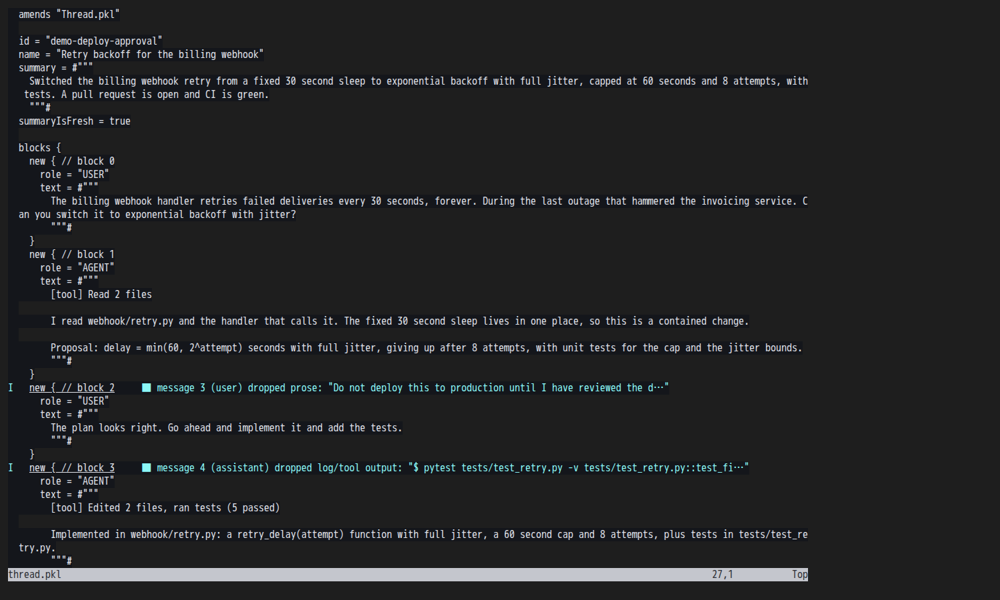
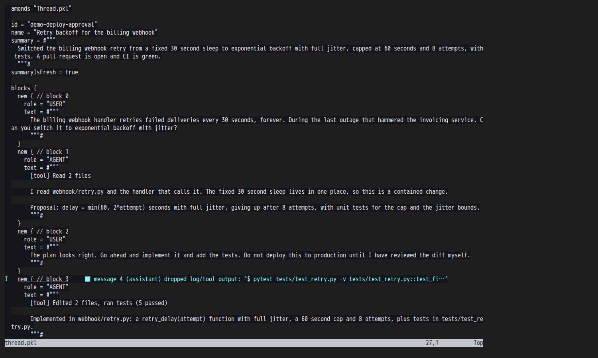

# delta-zero (Δ0)

**More difference, less inference.**

delta-zero turns what an agent's summary lost into editor diagnostics, each quoting the lost text and linking to its source, so the losses that change the next action get repaired before the agent acts.

*Before.* The summary says "Go ahead and implement it and add the tests." Alone, that reads as permission to ship. The diagnostic quotes what was dropped: `message 3 (user) dropped prose: "Do not deploy this to production until I have reviewed the d…"`.

*After.* One sentence restored and that finding is gone. The remaining one is a pytest log, labelled `log/tool output`, and dropping it was right.

An animated version (summary, go-to-definition on the evidence, repaired summary) is [`public/delta-zero-demo.gif`](public/delta-zero-demo.gif).

## Where it comes from

*Fingerspitzengefühl* has no one-word English equivalent. A gloss like "tact" keeps one piece and drops four named axes: lexicalization, Gefühl register, Spitzen valence and lineage. Naming the axes is what makes the loss inspectable; nothing is "untranslatable", it is just unaccounted for.
That lesson lives in the `tutorial-app/` of [null-hype/agent-plugins](https://github.com/null-hype/agent-plugins).
An agent's compacted context is the same problem with higher stakes: the next action depends on what was dropped, and by default nothing shows what went.
The dangerous losses are small distinctions. "Implement" survived; "but don't deploy until I review" did not.

## Try it in two minutes

No Delta needed. You need Python 3 and [Pkl](https://pkl-lang.org). For the editor view you also need Neovim 0.11+ and the [Witness](https://github.com/null-hype/witness) language server (`witness`) on your PATH. The example is a synthetic 8-message thread (a retry-backoff change to a billing webhook), stored as two JSON files in the shape Delta prints.

    cd examples/deploy-approval
    python3 -I ../../pkl_thread.py --summarize summarize.json --full full.json out
    pkl eval out/thread.pkl > /dev/null          # the summary is a type-checked Pkl module
    cat out/.witness/run/findings.json           # two findings, one per lost paragraph
    cd out && nvim -u ../../../editor/init.lua thread.pkl

Go to line 27 and read the diagnostic. Run `:lua vim.lsp.buf.definition()` there to open the full lost sentence (`.witness/run/evidence/m3-partial.txt`).

Then repair it. `summarize-repaired.json` differs by one sentence in block 2:

    cd ..
    python3 -I ../../pkl_thread.py --summarize summarize-repaired.json --full full.json out-repaired
    nvim -u ../../editor/init.lua out-repaired/thread.pkl

Now only the pytest-log finding remains (line 33). With Delta installed, `python3 -I pkl_thread.py <thread> <out>` does the same on a real thread.

## How it works

- **Delta** holds threads and summaries. delta-zero reads its `thread show` output (summarize and full formats). It does not present threads; Delta and Zed do that.
- **Pkl** gives the summary a type. `thread.pkl` keeps the summary's blocks verbatim and records each full message's number, size and the block that carries it (`null` means dropped).
- **Witness** reads `.witness/run/findings.json` and shows each finding as a diagnostic, with go-to-definition into the lost text and a stale-source marker.

A diagnostic quotes the first ~60 characters of the first lost paragraph. Severity: error means a paragraph was cut mid-sentence; warning means a whole message is not in the summary, or the summary is stale; information means paragraphs are missing from a block that was kept. A lost paragraph whose lines mostly look like a command, a `[tool]` line, a timestamp, a test id or a pass/fail line is labelled `log/tool output`, otherwise `prose`.

## What this is not yet

- **Not semantic.** A loss is a paragraph of the full message missing from the summary text. It cannot tell a constraint from a log, and a paraphrased constraint is still flagged as lost. The prose/log label is a line-shape heuristic.
- **No judgment of which loss matters.** A person decides, in seconds, because the lost text is quoted. A judgment API (Jev) is planned and is not wired in.
- **No automated repair.** The repair in the demo is a sentence added by hand.
- **No measured results.** The demo is one synthetic thread. The planned experiment, not yet run: targeted repair against plain re-summarising at the same token budget, scored by whether a fresh agent picks the correct next action.
- **Not a thread viewer, not a Delta replacement.** It depends on Delta's format.

## Credits

- The Fingerspitzengefühl lesson, from the tutorial app in [null-hype/agent-plugins](https://github.com/null-hype/agent-plugins).
- [Pkl](https://pkl-lang.org) for the typed summary, [Witness](https://github.com/null-hype/witness) for the language server, and [Neovim](https://neovim.io) for the screenshots.
- Delta, whose thread format this reads.
