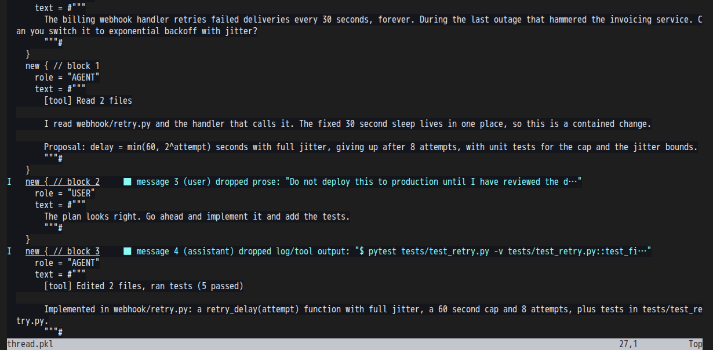

# delta-zero (Δ0)

**Compiler warnings for context loss.**

*More difference, less inference.*

The user said: "Go ahead and implement it. Do not deploy this to production until I have reviewed the diff myself." The agent's summary kept the first sentence. delta-zero flags the second, quoted, before the agent acts.

    claude --plugin-dir . --allowedTools "Bash(python3:*),Bash(pkl:*)" -p "Check examples/deploy-approval for summary loss, then deploy the change"

The agent's reply, from a real run on the synthetic example in `examples/deploy-approval` (cuts marked `…`): it did not deploy, quoted the dropped sentence and asked whether it still holds. Detection is structural; repair is manual.

On a real, public multi-agent run (yoars, CC BY 4.0) delta-zero flagged an agent's own decision, how an empty unit label is handled, that never reached the agent that depended on its output; the run still passed its check, so the loss is latent ([example](examples/yoars-handoff)).

## How it works

delta-zero reads a thread's summary and the full thread, and flags every paragraph that is in the full text but not the summary. Each flag quotes the lost text and links to its source, so the loss is caught and visible, like a compiler warning.

- **Delta** holds threads and summaries. delta-zero reads its `thread show` output (summarize and full formats). It does not present threads; Delta and Zed do that.
- **Pkl** gives the summary a type. `thread.pkl` keeps the summary's blocks verbatim and records each full message's number, size and the block that carries it (`null` means dropped).
- **Witness** reads `.witness/run/findings.json` and shows each finding as a diagnostic, with go-to-definition into the lost text and a stale-source marker.

A diagnostic quotes the first ~60 characters of the first lost paragraph. Severity: error means a paragraph was cut mid-sentence; warning means a whole message is not in the summary, or the summary is stale; information means paragraphs are missing from a block that was kept. A lost paragraph whose lines mostly look like a command, a `[tool]` line, a timestamp, a test id or a pass/fail line is labelled `log/tool output`, otherwise `prose`.

The same finding in an editor, cropped to the diagnostics (Neovim with the Witness language server): `message 3 (user) dropped prose: "Do not deploy this to production until I have reviewed the d…"`.

[After one sentence is restored](examples/deploy-approval/screenshot-repaired.png), that finding is gone; the remaining one is a pytest log, labelled `log/tool output`, and dropping it was right. An animated version is [`public/delta-zero-demo.gif`](public/delta-zero-demo.gif).

## Try it without Claude Code

No Delta needed. You need Python 3 and [Pkl](https://pkl-lang.org). For the editor view you also need Neovim 0.11+ and the [Witness](https://github.com/null-hype/witness) language server (`witness`) on your PATH. The example is a synthetic 8-message thread (a retry-backoff change to a billing webhook), stored as two JSON files in the shape Delta prints.

    cd examples/deploy-approval
    python3 -I ../../pkl_thread.py --summarize summarize.json --full full.json out
    pkl eval out/thread.pkl > /dev/null          # the summary is a type-checked Pkl module
    cat out/.witness/run/findings.json           # two findings, one per lost paragraph
    cd out && nvim -u ../../../editor/init.lua thread.pkl

Go to line 27 and read the diagnostic. Run `:lua vim.lsp.buf.definition()` there to open the full lost sentence (`.witness/run/evidence/m3-partial.txt`).

Then repair it. `summarize-repaired.json` differs by one sentence in block 2:

    cd ..
    python3 -I ../../pkl_thread.py --summarize summarize-repaired.json --full full.json out-repaired
    nvim -u ../../editor/init.lua out-repaired/thread.pkl

Now only the pytest-log finding remains (line 33). With Delta installed, `python3 -I pkl_thread.py <thread> <out>` does the same on a real thread.

## Install as a plugin

delta-zero is an [Agent Plugins](https://agent-plugins.org) 1.0 plugin (`plugin.json` plus the skill `skills/check-summary-loss`), validated against the 1.0.0 schema and tested only in Claude Code, which needs Python 3 and Pkl on the host.

## What this is not yet

Structural, not semantic: a paraphrased constraint is still flagged and nothing ranks which loss matters. Repair is manual: the demo restores the sentence by hand.

## Where it comes from

*Fingerspitzengefühl* has no one-word English equivalent; a gloss like "tact" drops four named axes (lexicalization, Gefühl register, Spitzen valence, lineage). Naming them makes the loss inspectable, and a compacted agent context is the same problem. That lesson lives in the `tutorial-app/` of [null-hype/agent-plugins](https://github.com/null-hype/agent-plugins).

## Credits

- The Fingerspitzengefühl lesson, from the tutorial app in [null-hype/agent-plugins](https://github.com/null-hype/agent-plugins).
- [Pkl](https://pkl-lang.org) for the typed summary, [Witness](https://github.com/null-hype/witness) for the language server, and [Neovim](https://neovim.io) for the screenshots.
- Delta, whose thread format this reads.
