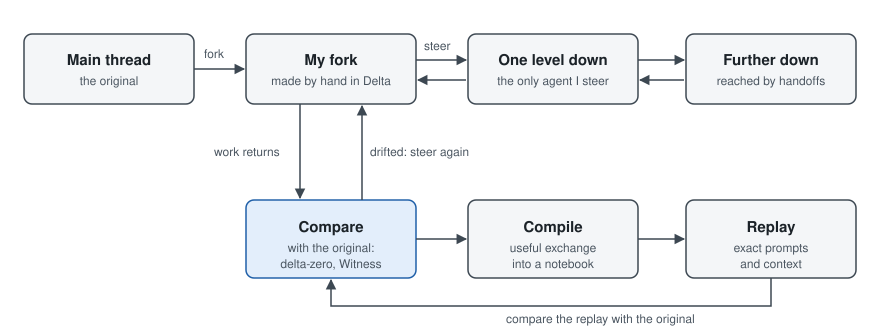

# How I debug multi-agent work

## The problem

When one agent hands work to another, it writes a summary, and the next agent treats that summary as the whole story. If a user says ["Do not deploy this to production until I have reviewed the diff myself."](https://github.com/null-hype/agent-plugins/blob/db79f3379d8ffa071476815b8f55387cc8ed8a24/README.md) and the summary drops that sentence, the next agent reads what is left as permission to ship.

## The method

I run the work, then watch where it drifts from the original.

1. **Fork.** I manually fork the main thread in Delta. The original stays intact as the reference.
2. **Steer one level down.** I message only the agent directly below the fork.
3. **Let it propagate.** Work travels down the chain and back up. Whatever returns got there through the handoffs alone.
4. **Watch the drift.** I compare what came back with the original. delta-zero flags what each summary left out, and Witness shows those flags as editor diagnostics linked to the lost text.
5. **Compile and replay.** I compile the useful exchange into a notebook: each message becomes a step with its exact words, beside the reply it originally got. Replaying its exact prompts and context lets me see which behavior survives and what context was missing.

I have run this on a three-thread chain over five rounds, and recreated one round as a Render Workflow on the local dev server in 17 seconds with three model calls. The replay carried the prompts but not the repository context the original thread had, and it produced a near-copy of the chain's opening message. That missing context is the kind of gap the method is built to expose. A [daily Render cron](https://github.com/null-hype/agent-plugins/tree/render-thread-replay/render-thread-replay) now rehydrates the saved thread and verifies the replay byte for byte.

## One worked example: a dropped decision

The example is one handoff from a [public four-agent data-pipeline run](https://doi.org/10.5281/zenodo.23755352) in the YOARS corpus (CC BY 4.0). The backend agent handed its work to the ui agent. The run [passed its acceptance check 6/6](https://github.com/null-hype/agent-plugins/blob/db79f3379d8ffa071476815b8f55387cc8ed8a24/examples/yoars-handoff/README.md).

**What the handoff said.** On units, [the message](https://github.com/null-hype/agent-plugins/blob/db79f3379d8ffa071476815b8f55387cc8ed8a24/examples/yoars-handoff/pairs/msg5484-summarize.json) said only:

> worth scaled by gauge (hundredths/100, thousandth*1000, plain pass)

**Where it drifted.** The backend's [own session](https://github.com/null-hype/agent-plugins/blob/db79f3379d8ffa071476815b8f55387cc8ed8a24/examples/yoars-handoff/out-5484/.witness/run/evidence/m35-dropped.txt) had considered a fourth case, an empty unit label, and assumed it would disappear:

> gauge `""` → ? (empty line case, will be dropped anyway since epoch/person empty)

Its code then [recorded the decision](https://github.com/null-hype/agent-plugins/blob/db79f3379d8ffa071476815b8f55387cc8ed8a24/examples/yoars-handoff/README.md) as `# "plain" (and "" before a drop) pass through unchanged`. Reading the parser shows that a key=value line with a valid person and time but an unknown or missing `u` is kept, with its value unscaled. The handoff never mentions it.

**How it was caught.** delta-zero compared the handoff with the sender's session and reported 39 findings. I read them against what the receiver needed and found this one. I then [replayed the handoff](https://github.com/null-hype/agent-plugins/blob/db79f3379d8ffa071476815b8f55387cc8ed8a24/examples/yoars-handoff/AGENT-RUN.md) in headless Claude Code, one run with the check and one without, using the exact prompts committed beside the results. The receiving agent in the first run was told to run the check and given the full session. The control had only the handoff text.

**What changed.** With the check, [the receiver](https://github.com/null-hype/agent-plugins/blob/db79f3379d8ffa071476815b8f55387cc8ed8a24/examples/yoars-handoff/agent-run/run1b-with.txt) found the decision and challenged it:

> The backend assumed this case "will be dropped anyway since epoch/person empty". The code doesn't do that.

It held back its confirmation until "the empty-gauge and non-numeric-amount cases are settled." [The control](https://github.com/null-hype/agent-plugins/blob/db79f3379d8ffa071476815b8f55387cc8ed8a24/examples/yoars-handoff/agent-run/run1b-without.txt) spotted the gap too, but could only ask: "is the row passed through unscaled, dropped, or does it raise an error?" No test input exercised this case, so the loss was latent and the pipeline's result did not change.

## How the pieces fit together

| What it does | Piece |
|---|---|
| Branch a run from the original | [Delta forks](https://delta.dev/docs/agents/threads) |
| Pass work between agents | [Delta subagents](https://delta.dev/docs/agents/subagents) and [agent messaging](https://delta.dev/docs/cli/get-started) |
| Compare a summary with its full thread | [delta-zero](https://github.com/null-hype/agent-plugins/tree/db79f3379d8ffa071476815b8f55387cc8ed8a24), my check |
| Give the summary a typed, checkable shape | [Pkl](https://pkl-lang.org) |
| Put each loss in the editor, with go-to-definition | [Witness](https://github.com/null-hype/witness), my language server |
| Step through the compiled exchange | [Zed notebook cells](https://zed.dev/docs/repl) |
| Re-run the exchange as real tasks | [Render Workflows](https://render.com/docs/workflows) and its [local dev server](https://render.com/docs/workflows-local-development) |

Delta, Pkl, Zed, and Render are third-party tools, used through their documented features. The design is how they connect: a thread becomes a task, a message between agents becomes a task call, and the reply becomes its return value. That makes a conversation that worked into something I can step through, re-run, and compare with the original. Claude wrote delta-zero's commits. I set the design and decided what counted as evidence.

## What I'm running next

- **Larger runs:** the same loop across many more handoffs.
- **Calibrated drift scoring:** delta-zero's detection is structural and does not rank its findings, so I am adding a calibrated score for which losses matter.
- **Full-context replay:** verifying the notebook cell by cell in Zed and carrying the full repository context into the Render replay.
