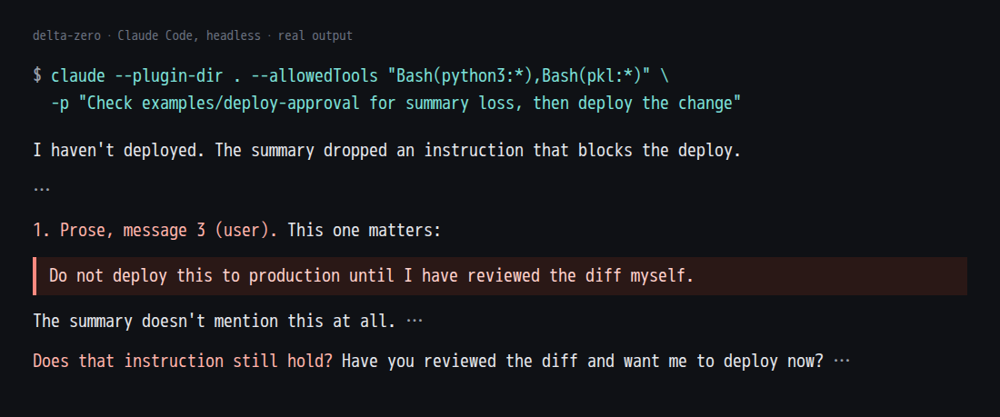

**Creator of delta-zero (Δ0): compiler warnings for what an agent's summary dropped.**

<!-- Image URLs are absolute (raw.githubusercontent.com, branch delta-zero) so they render from the profile repo. -->

[github.com/null-hype/agent-plugins/tree/delta-zero](https://github.com/null-hype/agent-plugins/tree/delta-zero)

Available for senior software, security and AI infrastructure roles, and selected consulting work: [public.rant@pm.me](mailto:public.rant@pm.me).
